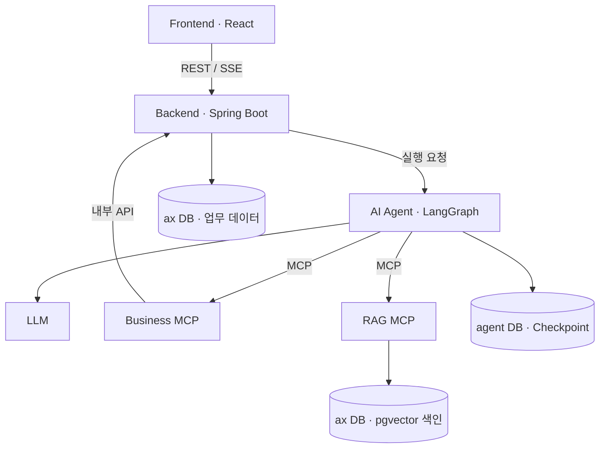

<div align="center">

# AXOX

### 데이터와 근거로 설계하는 기업의 AI 전환

기업 AX 진단 · AI 도입 과제 선정 · 투자 로드맵 · 승인 기반 프로젝트 등록


</div>

---

## Overview

**AXOX**는 기업의 업무 데이터와 내부 문서를 분석해 **예산 안에서 AI 도입 과제를 선정하고, 사용자 승인 후 실행 프로젝트로 연결하는 B2B AI Agent 플랫폼**입니다.

분산된 업무 정보와 도입 근거를 모아 기업의 AI 전환 준비 수준을 살피고, 기대 효과와 실현 가능성을 기준으로 투자 우선순위를 제안합니다. 사용자는 추천 이유, 비용, 근거 문서를 확인한 뒤 로드맵을 승인하거나 거절할 수 있습니다.

> **대상 사용자**: 중견·중소기업의 AX 전략 부서, AI 도입 컨설팅사

## Key Features

| 기능 | 설명 |
| --- | --- |
| **AX 성숙도 진단** | 기업의 업무 데이터와 내부 문서를 바탕으로 5개 영역의 성숙도와 근거 제시 |
| **AI 도입 과제 추천** | 업무 지표와 솔루션 카탈로그를 연결해 도입 후보 발굴 |
| **예산 기반 과제 선정** | 효과·실현 가능성, 예산, 업무 중복, 선행 과제를 고려해 과제 3개 선정 |
| **투자 로드맵** | 선정 과제의 비용, 추진 순서, 일정 초안과 투자 보조 지표 제공 |
| **근거 문서 조회** | RAG 검색 결과를 추천 이유와 연결하고 원문 확인 지원 |
| **사용자 승인** | 승인 단계에서 실행을 중단하고, 요청자 승인 후 로드맵·프로젝트 등록 |
| **진행 상태·이력** | SSE 진행 이벤트와 작업 이력 조회로 분석 과정 및 결과 확인 |

## User Flow

1. 로그인 후 자연어로 분석을 요청합니다.
2. Agent가 업무 데이터와 관련 문서를 수집합니다.
3. 성숙도를 진단하고 AI 도입 후보를 발굴합니다.
4. Backend가 AX점수와 비용을 계산하고 예산 내 과제 조합을 선정합니다.
5. 사용자가 추천 근거와 투자 로드맵을 확인합니다.
6. 승인하면 로드맵과 프로젝트를 등록하고, 거절하면 작업을 종료합니다.

**요청 예시**

> 현재 업무 데이터를 분석해서 AI 도입 효과가 높은 과제 3개를 선정하고, 예산 3억 원 내에서 AX 투자 로드맵을 만들어 줘.

## Architecture



### 서비스별 역할

| 구성 | 역할 |
| --- | --- |
| **Frontend** | 분석 요청, 진행 상태, 추천 결과, 로드맵, 근거 문서 및 승인 화면 |
| **Backend** | 인증 로직, 작업 상태 관리, 점수·금액 계산, 승인 검증, 업무 데이터 저장, SSE 중계 |
| **AI Agent** | 데이터 수집, 근거 해석, 성숙도 평가, 후보 제안, 실행 분기 및 승인 대기·재개 |
| **Business MCP** | 업무 조회·계산·변경 도구를 Spring 내부 API와 연결 |
| **RAG MCP** | pgvector 기반 근거 검색과 문서 원문 Resource 제공 |
| **PostgreSQL** | `ax` DB에 업무·벡터 데이터, `agent` DB에 실행 상태 저장 |

### 설계 원칙

- **업무 규칙 단일화**: 점수·금액 계산과 업무 데이터 변경은 Spring에서 처리합니다.
- **비동기 작업 처리**: 요청을 `202 Accepted + taskId`로 접수하고 SSE로 진행 이벤트를 전달합니다.
- **변경 전 승인**: LangGraph의 `interrupt`와 체크포인터로 실행을 멈추고 승인 후 같은 작업을 재개합니다.
- **근거 기반 설명**: 내부 문서 검색 결과를 추천 이유와 연결합니다.
- **중복 등록 방지**: 작업·항목 식별자와 저장 검증으로 중복 생성을 방지합니다.

## AI Workflow

단일 LangGraph `StateGraph` 안에서 8개 노드가 역할을 나눕니다.

| 노드 | 역할 |
| --- | --- |
| `collect` | 기업·업무·지표·시스템·예산·카탈로그 수집 |
| `retrieve` | 문서 검색, 재검색 및 근거 중복 제거 |
| `assess` | 5개 영역 성숙도 평가와 근거 검증 |
| `discover` | 도입 후보 제안, 정책 제외 및 선행 과제 보완 |
| `evaluate` | Spring 계산 도구 호출, 과제 조합 선정 및 응답 검증 |
| `roadmap` | 추진 순서와 3개월 단위 일정 초안, 결과 설명 생성 |
| `approval` | 실행 중단, 상태 저장, 요청자의 승인·거절 대기 |
| `register` | 승인된 로드맵과 프로젝트 등록 |

유효한 조합이 부족하면 `evaluate`에서 `discover`로 돌아가 최대 2회 재탐색합니다. 모델은 도구 선택과 해석·제안을 담당하며, 검색·계산·등록의 실행 순서는 Graph가 통제합니다.

## Selection Policy

기업의 **성숙도 진단**과 도입 과제의 **AX점수**는 별도로 관리합니다. 과제 선정에는 다음 MVP 정책을 사용합니다.

```text
AX점수 = Impact × 0.6 + Feasibility × 0.4
```

| 지표 | 기준 |
| --- | --- |
| **Impact** | 전체 선정 가능 후보의 최대 예상 절감시간 대비 해당 후보의 예상 절감시간 |
| **Feasibility** | 업무 표준화 수준과 솔루션의 API 조건 충족 여부 |
| **초년도 총비용** | 구축비 + 월 운영비 × 12 |

선정 가능한 후보의 3개 조합을 전수 탐색하고, **예산·업무 중복·선행 과제 조건을 충족하는 조합 중 AX점수 합이 가장 큰 조합**을 선택합니다. 동점이면 기준 시나리오의 3년 순편익, 총비용 순으로 비교합니다.

회수 기간·3년 순편익·1년 ROI는 보수·기준·낙관 시나리오의 **보조 지표**로 제공합니다.

> 점수 가중치는 MVP 자체 설계입니다. 시연 데이터의 절감액은 가정 기반 인력 시간 환산 가치이며, 실측 현금 절감 성과를 의미하지 않습니다.

## Tech Stack

| 영역 | 기술 |
| --- | --- |
| **Frontend** | React 19 · TypeScript · Vite · Tailwind CSS v4 |
| **Backend** | Java 21 · Spring Boot 4.1.1 · Spring Security · Spring Data JPA |
| **AI Agent** | Python · FastAPI · LangGraph · LangChain · LLM API |
| **MCP / RAG** | FastMCP · Streamable HTTP · Embedding · pgvector |
| **Database** | PostgreSQL |
| **Infra** | Docker Compose · Vercel · GCP Cloud Run / Cloud SQL 관련 설정 |
| **Observability** | 실행 이벤트 · LLM usage · LangSmith 연동 |
